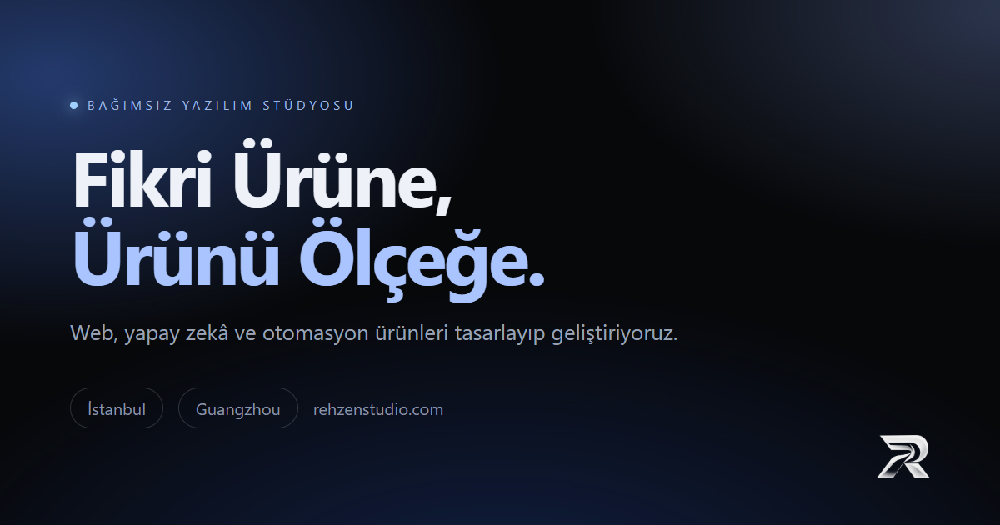

  

<a href="https://rehzenstudio.com/">rehzenstudio.com</a>
·
<a href="mailto:hello@rehzenstudio.com">hello@rehzenstudio.com</a>

---

## Ne geliştiriyorum

Rehzen Studio’da web, yapay zekâ ve otomasyon ürünlerini fikirden yayına kadar tasarlıyor ve geliştiriyorum. Amaç; iyi görünen değil, gerçekten çalışan, ölçülebilen ve büyüyebilen ürünler çıkarmak.

| 01 / WEB | 02 / AI & AGENTS |
| --- | --- |
| Kurumsal siteler, ürün panelleri ve satış odaklı vitrinler. | Agent çalışma alanları, LLM entegrasyonları ve üretkenlik araçları. |

| 03 / AUTOMATION | 04 / GAMES |
| --- | --- |
| API entegrasyonları, iş akışları ve operasyon otomasyonu. | Rehzen Games ürünleri ve interaktif deneyimler. |

## Ürünler ve çalışma alanları

- **Rehzen Studio** — Web, yapay zekâ ve otomasyon ürünleri.
- **Rehzen Games** — Kendi oyunlarımızı geliştiren ve yayınlayan stüdyo kolu.
- **Bir Ömür** — Yaşam simülasyonu odağındaki kendi ürünümüz.
- **Agent Systems** — Hafıza, bağlam, araçlar ve yürütmeyi tek akışta buluşturan deneyler.

## Çalışma modeli

`Keşif` → `Tasarım & Prototip` → `Geliştirme` → `Yayın & Ölçüm`

Kısa bir brief ile başlarım. Kapsamı netleştirir, çalışan bir prototipi erken gösterir, iki haftalık döngülerle ürünü ilerletirim.

## Teknoloji

`TypeScript` · `React` · `Next.js` · `Node.js` · `Python` · `PostgreSQL` · `Docker` · `AWS` · `LLM API` · `Playwright`

## Bir proje konuşalım

Yeni bir ürün, mevcut bir kod tabanı veya otomatikleştirilecek bir süreç varsa doğrudan yazabilirsin.

  <a href="https://rehzenstudio.com/">Web sitesini ziyaret et →</a>
  ·
  <a href="mailto:hello@rehzenstudio.com">hello@rehzenstudio.com</a>

  © 2026 Rehzen Studio · Ürün, kod ve tasarım.

